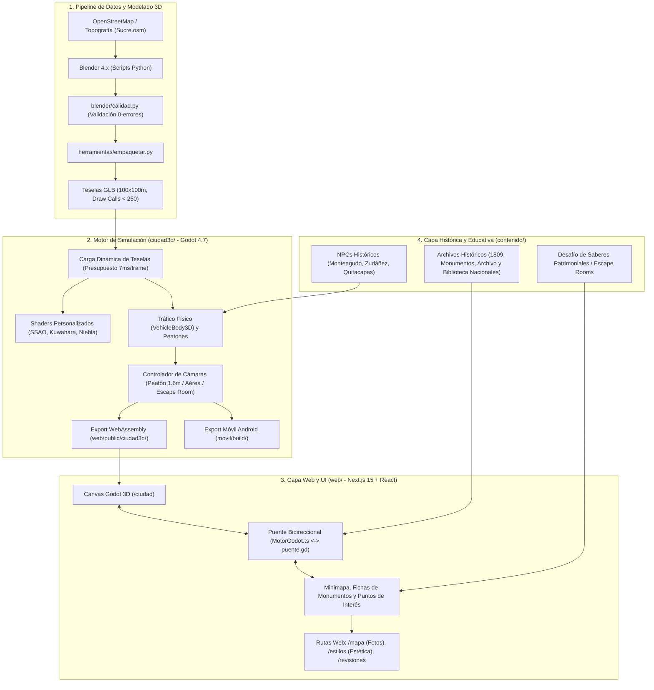

# Estructura y Arquitectura del Proyecto: Mi Ciudad Charcas (Sucre 3D)

> **Ubicación del Proyecto Analizado:** `c:\Users\antra\Desktop\Hacka_American_Spaces(CBA)\miCiudadCharcas`  
> **Fecha de Documentación:** Noviembre 2026  
> **Área:** Patrimonio Histórico, Educación Interactiva, Gemelo Digital 3D, Hackathon American Spaces

---

## 1. Resumen Ejecutivo del Proyecto

**Mi Ciudad Charcas / Sucre 3D** es un gemelo digital interactivo y plataforma educativa inmersiva que recrea el Centro Histórico de la ciudad de Sucre (la histórica Charcas, Capital Constitucional de Bolivia y Patrimonio Cultural de la Humanidad por la UNESCO).

El proyecto integra:
1. **Un motor 3D de alto rendimiento (Godot 4.7 WebAssembly / WebGL2)** para la navegación en primera persona (altura de ojos a 1.60 m), vista aérea, ciclo diurno/nocturno, y simulación de tráfico físico en tiempo real (microbuses tradicionales).
2. **Una aplicación web moderna (Next.js 15+ / React)** que actúa como envolvente interactiva, ofreciendo minimapa, fichas históricas, selector de estilos visuales, auditoría de fotografías patrimoniales y comunicación bidireccional mediante un puente TypeScript $\leftrightarrow$ GDScript.
3. **Un pipeline de automatización 3D en Blender** capaz de procesar datos geoespaciales (OpenStreetMap, LiDAR y modelos fotogramétricos) convirtiéndolos en manzanas urbanas optimizadas (GLB teselado).
4. **Una capa de contenido histórico y gamificación educativa** basada en eventos reales (la Revolución del 25 de Mayo de 1809, personajes históricos como Monteagudo, Zudáñez y el "Quitacapas", y mecánicas de Escape Room histórico y Desafío de Saberes Patrimoniales).

---

## 2. Diagrama de Arquitectura Global

---

## 3. Desglose Módulo por Módulo

A continuación se detalla cada carpeta y subsistema que compone el repositorio `miCiudadCharcas`:

### 3.1. `ciudad3d/` — Motor Central de Simulación (Godot 4.7)
Es el núcleo 3D interactivo migrado a Godot 4.7 para garantizar 60 FPS estables y soporte multiplataforma (Web WebGL2 y Android).
- **`project.godot`**: Configuración maestro del proyecto Godot.
- **`puente.gd`**: Script conector de eventos entre el entorno web de React/Next.js y el motor Godot (recibe saltos de cámara, selección de manzanas y emite clics a monumentos o coordenadas del jugador).
- **`camara.gd`**: Sistema de cámaras intercambiables:
  - *Modo Peatonal:* Restringido rígidamente a 1.60 m sobre el nivel del suelo, con velocidad humana de caminata para mantener escala 1:1.
  - *Modo Aéreo / Dron:* Navegación orbital e isométrica sobre el centro histórico.
  - *Modo Cinemático:* Trayectorias pregrabadas para presentaciones y tours guiados.
- **`oclusion.gdshader` / `estilos.gdshader`**: Shaders GLSL optimizados para renderizado web. Implementa Ambient Occlusion en espacio de pantalla ligero y el filtro pictórico Kuwahara para estética colonial.
- **`trafico/`**: Simulación física de vehículos mediante nodos `VehicleBody3D`, parametrizados para emular los microbuses de las líneas tradicionales de Sucre (Línea 1, Línea 2, Línea Q).
- **`LEEME.md`**: Bitácora técnica donde se documenta la transición tecnológica, reducción de draw calls (de 742 a 241) y tiempos de frame (< 7 ms).

---

### 3.2. `web/` — Aplicación Web y Envolvente Interactiva (Next.js 15)
Construida con React, TypeScript y Tailwind CSS. Gestiona la experiencia de usuario, interfaz de usuario (HUD) y herramientas de inspección.
- **`app/ciudad/page.tsx`**: Contenedor principal del canvas Godot WebAssembly. Carga el loader de la ciudad 3D y despliega el HUD.
- **`app/mapa/page.tsx`**: Visor de georreferenciación que vincula fotografías de fachadas y balcones coloniales con las coordenadas del mapa.
- **`app/estilos/page.tsx`**: Herramienta de visualización de los 5 estilos estéticos de la ciudad (fotorrealista, acuarela histórica, plano técnico, modo nocturno colonial, y maqueta arquitectónica).
- **`app/api/revisiones/`**: Endpoints para auditoría de calidad, reporte de fallas (p. ej. solapamiento de edificios) y telemetría.
- **`lib/MotorGodot.ts`**: Cliente TypeScript que expone métodos para invocar funciones GDScript dentro del WebAssembly en tiempo real.
- **`public/ciudad3d/`**: Contenedor de los binarios exportados de Godot (`.wasm`, `.pck`, `.js`).

---

### 3.3. `blender/` — Pipeline de Modelado y Calidad Automatizada
Scripts en Python diseñados para ser ejecutados desde la terminal o internamente en Blender:
- **`calidad.py`**: **Herramienta crítica de QA**. Audita la escena 3D y verifica:
  1. Que ningún árbol o farola quede flotando en el aire.
  2. Que los cables de luz y postes no atraviesen geometrías habitables.
  3. Que las edificaciones no presenten z-fighting (solapamiento de polígonos).
  4. Salida binaria requerida antes de cualquier release: **0 errores**.
- **`piloto.py` / `preparar_mapa.py`**: Scripts de ingesta de curvas de nivel, traza vial y generación de volúmenes a partir de huellas catastrales.
- **Transformación de Coordenadas:** Maneja la conversión estricta de coordenadas Blender ($Z$-arriba) hacia Web/Godot ($Y$-arriba).

---

### 3.4. `contenido/` — Base Histórica, Narrativa y Gamificación
Alberga la documentación académica, guiones y fichas patrimoniales:
- **`ideas_ciudad_viva.md`**: Diseño de vida urbana histórica. Establece rutas de personajes célebres:
  - *Francisco Ríos ("El Quitacapas"):* Personaje legendario de las noches sucrenses.
  - *Bernardo Monteagudo y Jaime Zudáñez:* Ideólogos del Primer Grito Libertario de América (25 de mayo de 1809).
  - *Mariana Zudáñez:* Rescate patriótico y vida social en la colonia.
- **`lugares/`**: Fichas patrimoniales detalladas:
  - *Casa de la Libertad* (Cuna de la República).
  - *Catedral Metropolitana y Capilla de la Virgen de Guadalupe*.
  - *Convento y Templo de San Francisco* (Campana de la Libertad).
  - *San Felipe Neri* (Mirador de techos y terrazas coloniales).
  - *Plaza 25 de Mayo* (Plaza Mayor de Charcas).
- **`TEXTO-DESAFIO-DE-SABERES-PATRIMONIALES.docx`**: Banco de preguntas, acertijos y trivias para la evaluación gamificada de estudiantes y turistas.

---

### 3.5. `coordinacion/` — Partición de Trabajo y Estado de Manzanas
Gestión modular del territorio urbano:
- **`estado_claude.md`**: Registro exhaustivo manzana por manzana (M001 a M065, P01 Plaza Central). Detalla estado de modelado, texturizado, optimización, iluminación nocturna y rendimiento.
- **`TAREA_CLAUDE.md`**: Matriz de asignación de zonas:
  - **Partición Norte:** Asignada a `claude` (Calle José Álvarez de Arenales hacia el Norte).
  - **Partición Sur:** Asignada a `codex` (Calle José Álvarez de Arenales hacia el Sur).
- **`revisiones/`**: Registro de incidencias geométricas y visuales identificadas en pruebas.

---

### 3.6. `autos/`, `Peatonal/`, `reparto/` y `herramientas/`
- **`autos/`**: Modelos 3D de vehículos típicos (microbuses Dodge/Toyota antiguos de Sucre, taxis, autos particulares).
- **`Peatonal/`**: Modelos y rigs de personajes de época y transeúntes contemporáneos.
- **`herramientas/empaquetar.py`**: Generador de paquetes de entrega y teselado. Empaqueta mallas, materiales atlas y colisiones en fragmentos GLB de 100x100 m.

---

## 4. Pipeline de Datos y Flujo de Ejecución

El ciclo de vida de un asset desde su concepción hasta el navegador sigue un flujo riguroso:

1. **Ingesta de Datos:** Se toma la traza urbana de Sucre (`Sucre.osm.*`), datos de elevación y fotos de fachadas.
2. **Generación 3D en Blender:** Se ejecutan los scripts de extrusión, modelado colonial y optimización UV.
3. **Control de Calidad Automático:** Se corre `python blender/calidad.py`. Si arroja más de 0 advertencias críticas, se rechaza la manzana.
4. **Exportación e Integración en Godot:** Se exporta a GLB en `ciudad3d/escenas/manzanas/`. Godot genera las colisiones y asigna shaders.
5. **Compilación a WebAssembly:** Se ejecuta el exportador de Godot a WebGL2 (`web/public/ciudad3d/`).
6. **Despliegue Web:** Next.js sirve la aplicación, conectando el canvas 3D con la interfaz de usuario React y el sistema de audio.

---

## 5. Reglas Técnicas y Convenciones Obligatorias

1. **Escala 1:1 Rigurosa:** Las calles y edificios respetan dimensiones métricas reales para garantizar valor pedagógico y arquitectónico.
2. **Altura de Ojos Peatonal:** 1.60 m sobre la rasante de calle.
3. **Presupuesto de Rendimiento Web:**
   - Máximo 250 Draw Calls en la toma panorámica de la Plaza 25 de Mayo.
   - Tiempo de procesamiento por frame en carga de teselas: $\le 7\text{ ms}$.
   - Tasa de cuadros por segundo meta: **60 FPS** estables en navegadores estándar.
4. **Texturas en Atlas:** Se prohíbe el uso de texturas individuales por edificio; se utilizan atlas compartidos de calicanto, teja colonial, rejería y madera.
