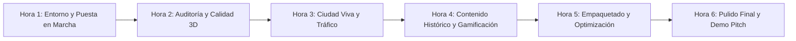

# Plan de Trabajo Intensivo de 6 Horas: Mi Ciudad Charcas (Sucre 3D)

> **Destino:** `c:\Users\antra\Desktop\Hacka_American_Spaces(CBA)\Mi_Ciudad_Sucre\guia\PLAN_DE_TRABAJO_6_HORAS.md`  
> **Metodología:** Sprint de Alta Intensidad para Hackathon (6 Bloques de 60 Minutos)  
> **Objetivo Final:** Entregar un prototipo interactivo 3D completamente funcional, visualmente impactante, con contenido histórico pedagógico, rendimiento a 60 FPS y una ruta demostrativa impecable para el jurado calificador.

---

## 1. Visión General del Sprint

Este plan organiza 6 horas de trabajo continuo en fases secuenciales y medibles. Cada hora cuenta con:
- **Objetivo central**
- **Acciones técnicas concretas**
- **Comandos y archivos involucrados**
- **Criterio de aceptación (Done Definition)**



---

## 2. Cronograma Detallado Hora por Hora

---

### Hora 1 (00:00 - 01:00) | Diagnóstico, Entorno y Puesta en Marcha

#### Objetivo:
Levantar la aplicación web, verificar la compilación de Godot 4.7 y comprobar la carga de la escena 3D en el navegador sin errores críticos de consola.

#### Acciones Técnicas:
1. **Verificación de Herramientas del Sistema:**
   - Confirmar versiones de Node.js (v18+ / v20+), npm, Python 3.10+ y Godot 4.7.
2. **Puesta en marcha del Frontend Next.js:**
   - Navegar a la carpeta `web/` e instalar dependencias si faltan.
   - Ejecutar el servidor de desarrollo en modo local:
     ```powershell
     cd c:\Users\antra\Desktop\Hacka_American_Spaces(CBA)\miCiudadCharcas\web
     npm install
     npm run dev
     ```
   - Abrir en el navegador: `http://localhost:3000` y comprobar las rutas `/ciudad`, `/mapa` y `/estilos`.
3. **Auditoría de Assets WebAssembly:**
   - Verificar la existencia de los binarios exportados en `web/public/ciudad3d/` (`ciudad3d.wasm`, `ciudad3d.pck`, `ciudad3d.js`).
   - Si no existen o están desactualizados, abrir el proyecto `ciudad3d/project.godot` en Godot y generar la exportación Web (Perfil WebGL2 / Compatibility).

#### Entregable de la Hora 1:
- Servidor web corriendo en `localhost:3000`.
- El canvas 3D carga la Plaza 25 de Mayo en pantalla y el usuario puede rotar la cámara básica.

---

### Hora 2 (01:00 - 02:00) | Auditoría de Calidad 3D y Optimización de la "Zona Cero"

#### Objetivo:
Asegurar que la zona neurálgica de la ciudad (Plaza 25 de Mayo - P01, Casa de la Libertad, Catedral Metropolitana y San Francisco) esté impecable, sin objetos flotantes ni colisiones rotas, cumpliendo el estándar de calidad cero errores.

#### Acciones Técnicas:
1. **Ejecución del Script de Control de Calidad:**
   - Ejecutar el validador en Python:
     ```powershell
     cd c:\Users\antra\Desktop\Hacka_American_Spaces(CBA)\miCiudadCharcas
     python blender/calidad.py
     ```
   - Revisar el reporte de árboles flotantes, solapamiento de mallas (z-fighting) y cables eléctricos desalineados.
2. **Corrección Focalizada en la Plaza Central (P01 y M001-M004):**
   - Asegurar que la cota de suelo de la Plaza 25 de Mayo esté nivelada a $Y = 0.0$ con colisión sólida para el jugador.
   - Verificar que los monumentos emblemáticos (estatua del Mariscal Sucre, frontis de Casa de la Libertad y torre de la Catedral) tengan sus materiales atlas correctamente vinculados.
3. **Chequeo de Presupuesto de Rendimiento:**
   - Abrir las herramientas de desarrollo del navegador (`F12`).
   - Medir draw calls: deben mantenerse por debajo de 250 en la vista de la plaza.
   - Ajustar distancia de visión (culling) si los FPS bajan de 45.

#### Entregable de la Hora 2:
- Reporte `calidad.py` con 0 errores críticos en las manzanas centrales.
- Plaza 25 de Mayo transitable a pie sin caídas al vacío ni parpadeo de texturas.

---

### Hora 3 (02:00 - 03:00) | Activación de la "Ciudad Viva" (Tráfico y Dinámica Urbana)

#### Objetivo:
Transformar la maqueta estática en una ciudad viva, con microbuses característicos en movimiento físico y transeúntes en puntos clave.

#### Acciones Técnicas:
1. **Implementación de Rutas de Microbuses:**
   - Ubicar los nodos de tráfico en `ciudad3d/trafico/`.
   - Activar los trazados viales con `Path3D` y `PathFollow3D` o mediante los cuerpos `VehicleBody3D` en las arterias principales:
     - Calle Argentina $\rightarrow$ Calle Calvo (hacia San Roque).
     - Calle España $\rightarrow$ Calle Camargo.
     - Calle Arenales $\rightarrow$ Calle Junín.
   - Asignar texturas características a los micros (Línea 1 blanco/rojo, Línea 2 verde).
2. **Sistema Peatonal y Altura de Ojos (1.60 m):**
   - Configurar el nodo de jugador en `ciudad3d/camara.gd` para bloquear rígidamente la cámara a 1.60 m sobre la rasante.
   - Configurar velocidad de paso natural ($1.3\text{ m/s}$) y modo carrera suave ($2.8\text{ m/s}$).
   - Añadir 4 a 6 personajes de fondo en los portales de la plaza (animaciones simples idle/walk de `Peatonal/`).
3. **Ciclo Día / Noche y Shaders de Época:**
   - Configurar el shader `ciudad3d/oclusion.gdshader` y la luz direccional del Sol.
   - Verificar la transición al atardecer/noche colonial: encendido de faroles de hierro forjado con luz cálida (3000K).

#### Entregable de la Hora 3:
- Microbuses circulando de forma continua por el perímetro de la Plaza 25 de Mayo.
- Jugador caminando a pie con sensación de escala humana real y opción de conmutar luz diurna/nocturna.

---

### Hora 4 (03:00 - 04:00) | Gamificación e Integración del Contenido Histórico

#### Objetivo:
Conectar la base histórica de Charcas (`contenido/`) con elementos interactivos dentro del gemelo digital, activando Puntos de Interés (POI) y el primer personaje histórico interactivo.

#### Acciones Técnicas:
1. **Puntos de Interés Interactivos (Triggers 3D):**
   - Insertar marcadores 3D o auras de luz interactiva frente a:
     - **Casa de la Libertad:** Ficha interactiva con la firma del Acta de Independencia de 1825.
     - **Catedral Metropolitana:** Audio o campaneo de fondo y reseña arquitectónica barroco-renacentista.
     - **Templo de San Francisco:** La historia de la Campana de la Libertad del 25 de mayo de 1809.
2. **Sincronización React $\leftrightarrow$ Godot (`MotorGodot.ts` y `puente.gd`):**
   - Cuando el jugador se aproxima a un monumento o hace clic sobre él, `puente.gd` emite un evento JS:
     ```typescript
     window.dispatchEvent(new CustomEvent('monumento_seleccionado', { detail: { id: 'casa_libertad' } }));
     ```
   - En Next.js (`web/app/ciudad/page.tsx`), desplegar una tarjeta modal flotante con la imagen histórica, texto pedagógico y audio extraído de `contenido/lugares/`.
3. **Aparición de Personaje Histórico (NPC de Misión):**
   - Incorporar al personaje de **Francisco Ríos "El Quitacapas"** o **Bernardo Monteagudo** cerca de la esquina de la Calle Arenales.
   - Al interactuar, lanzar un acertijo o pregunta del `TEXTO-DESAFIO-DE-SABERES-PATRIMONIALES.docx` con respuesta de opción múltiple.

#### Entregable de la Hora 4:
- Al menos 3 puntos de interés patrimonial activos con tarjetas educativas desplegables.
- Un NPC histórico con diálogo y un desafío educativo interactivo.

---

### Hora 5 (04:00 - 05:00) | Empaquetado, Rendimiento y Pruebas Multiplataforma

#### Objetivo:
Optimizar la compilación final, verificar estabilidad de memoria y garantizar compatibilidad para presentación (Web sin caídas y fallback local/offline).

#### Acciones Técnicas:
1. **Compilación de Producción:**
   - Ejecutar la exportación completa en Godot:
     ```powershell
     cd c:\Users\antra\Desktop\Hacka_American_Spaces(CBA)\miCiudadCharcas
     npm run ciudad
     ```
   - Compilar la aplicación web Next.js para producción o verificar estabilidad en desarrollo optimizado:
     ```powershell
     cd web
     npm run build
     ```
2. **Prueba de Compatibilidad de Pantalla y Controles:**
   - Comprobar funcionamiento en pantalla completa (`F11`).
   - Verificar controles universales: Teclado (`W-A-S-D` o flechas + ratón) y controles táctiles en pantalla para tablets o móviles.
3. **Preparación de Fallback Offline (Plan B):**
   - Configurar un servidor estático local o la versión ejecutable nativa de Godot (`MiCiudad-Sucre.exe` o Android `.apk`) en caso de que la red Wi-Fi del evento sufra interrupciones.

#### Entregable de la Hora 5:
- Build de producción compilado y probado sin caídas de memoria (memory leak free).
- Respaldo ejecutable local listo para correr sin conexión a internet.

---

### Hora 6 (05:00 - 06:00) | Pulido Visual, Ruta Demostrativa ("Golden Path") y Pitch

#### Objetivo:
Pulir detalles cosméticos, ensayar la ruta guiada de 2 minutos para el jurado y estructurar el discurso de impacto tecnológico y educativo.

#### Acciones Técnicas:
1. **Configuración de la "Ruta de Oro" (Demo Loop de 2 Minutos):**
   - **Segundo 0 a 30:** Inicio en vista aérea cenital sobre Sucre colonial al atardecer $\rightarrow$ descenso cinematográfico hacia la Plaza 25 de Mayo.
   - **Segundo 30 a 60:** Conmutación a modo peatonal a 1.60 m. Paso de un micro tradicional de la Línea 1 con sonido característico.
   - **Segundo 60 a 90:** Aproximación a la Casa de la Libertad $\rightarrow$ apertura de la ficha patrimonial interactiva.
   - **Segundo 90 a 120:** Encuentro con el personaje histórico Bernardo Monteagudo $\rightarrow$ resolución de la trivia del 25 de Mayo de 1809 con feedback visual en tiempo real.
2. **Audio y Ambientación:**
   - Activar audio ambiental colonial tenue (campanas lejanas, murmullo urbano, viento).
3. **Estructura del Pitch (3 minutos de exposición):**
   - **El Problema:** El patrimonio arquitectónico y la historia viva de ciudades coloniales como Sucre a menudo se enseñan de forma estática en libros o con costosas maquetas inaccesibles para escuelas lejanas.
   - **La Solución:** *Mi Ciudad Charcas* — un gemelo digital interactivo, liviano (corre en navegador web), fiel a escala 1:1, donde los estudiantes exploran la historia en primera persona sin riesgo físico ni barreras geográficas.
   - **Diferenciador Técnico:** Arquitectura híbrida Godot 4.7 Wasm + Next.js + Blender QA Pipeline; simulación física de tráfico real y gamificación patrimonial.
   - **Impacto y Escalabilidad:** Fácilmente extensible a otras ciudades patrimoniales (Potosí, La Paz, centros históricos de las Américas).

#### Entregable de la Hora 6:
- Demostración ensayada y cronometrada.
- Presentación lista con diapositivas de apoyo o pitch directo sobre la pantalla del gemelo digital.

---

## 3. Matriz de Roles y Asignación de Responsabilidades

| Rol | Foco Principal | Responsabilidad por Hora |
| :--- | :--- | :--- |
| **Ingeniero 3D / Godot** | Motor y Gráficos | H1: Export Wasm $\rightarrow$ H2: Optimización draw calls $\rightarrow$ H3: Tráfico y cámaras $\rightarrow$ H4: Eventos 3D $\rightarrow$ H5: Build nativo $\rightarrow$ H6: Cámaras de demo |
| **Desarrollador Web / Fullstack** | Next.js y Puente | H1: Setup Next.js $\rightarrow$ H2: Ajustes UI $\rightarrow$ H3: Controles HUD $\rightarrow$ H4: Fichas y modales $\rightarrow$ H5: Build web $\rightarrow$ H6: Puesta a punto final |
| **Diseñador de Contenido / Historia** | Narrativa y QA | H1: Revisión de textos $\rightarrow$ H2: Test `calidad.py` $\rightarrow$ H3: Ajuste de estética colonial $\rightarrow$ H4: Trivias y diálogos $\rightarrow$ H5: Pruebas de usabilidad $\rightarrow$ H6: Preparación del Pitch |

*Nota: Si el trabajo es individual, ejecutar estrictamente la secuencia horaria definida en la sección 2.*

---

## 4. Matriz de Riesgos y Planes de Contingencia

| Riesgo Identificado | Probabilidad | Impacto | Plan de Mitigación Inmediato |
| :--- | :---: | :---: | :--- |
| **Fallo al exportar WebAssembly en Godot 4.7** | Media | Alto | Usar de inmediato la exportación nativa de escritorio para PC (`.exe`) o el build previo existente en `web/public/ciudad3d/`. |
| **Caída de FPS en la vista panorámica (< 30 FPS)** | Media | Medio | Reducir la distancia de niebla (`far culling`), desactivar el shader Kuwahara y mantener únicamente la oclusión ambiental básica. |
| **Corte de conexión a Internet durante la feria/hackathon** | Alta | Crítico | Todo el sistema debe correr sobre `localhost` (100% autónomo). No depender de CDNs externas ni APIs de terceros en la demo en vivo. |
| **El jurado tiene poco tiempo (< 2 min)** | Alta | Alto | Iniciar directamente en la Plaza 25 de Mayo frente a Casa de la Libertad sin pasar por menús preliminares ni pantallas de carga prolongadas. |

---

## 5. Checklist de Verificación Final (Minuto 350 - 360)

- [ ] ¿El servidor web arranca con un solo comando (`npm run dev` o `npm start`)?
- [ ] ¿La cámara peatonal respeta la altura de 1.60 m sin atravesar el suelo?
- [ ] ¿Los micros y vehículos circulan fluidamente sin colisionar entre sí de forma anómala?
- [ ] ¿Al hacer clic en Casa de la Libertad se despliega la información patrimonial?
- [ ] ¿El desafío de preguntas históricas ofrece respuesta y retroalimentación interactiva?
- [ ] ¿El audio y los efectos visuales (día/noche) responden ágilmente?
- [ ] ¿Existe una copia de seguridad en memoria USB o branch limpio de Git?
